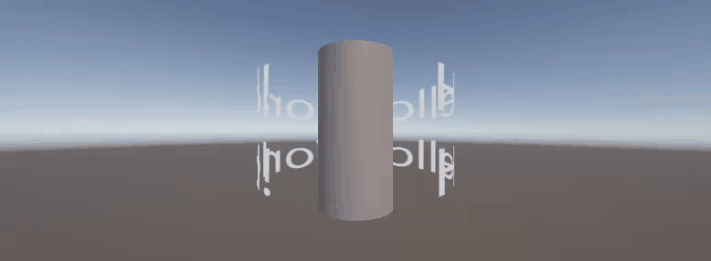
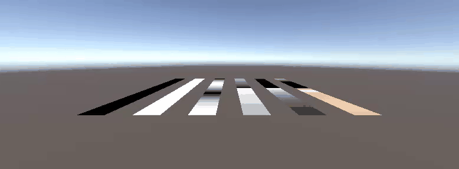
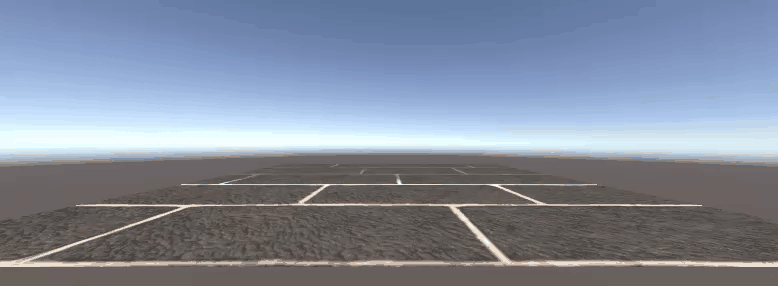
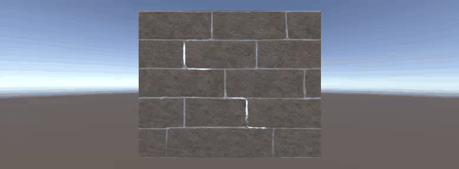

# はじめに
プログラムワークショップIVの管理用です

# 結果画像

- 工夫した点：
  - レンガ(tile.png)の目地に沿って、あみだくじのように縦→横→縦と折れ曲がる1本の経路を光が一定の速さで流れるようにした。
  - 道のりは距離に比例し、Sine Time ではなく Time を使っているので、縦線でも横線でも速さが変わらない。
  - 光を乗せる範囲(Alpha)も経路だけに絞り、他の目地は光らないようにした。

# 進め方

- 本リポジトリをforkしてください
- fork先のリポジトリを更新してください
- Unityのプロジェクトをsrc内で進めてください
- 結果を画面キャプチャして、画像としてリポジトリに追加して、上記のリンクから見られるようにしてください
- 完成したら本リポジトリのmainブランチにpull requestを投げてください
